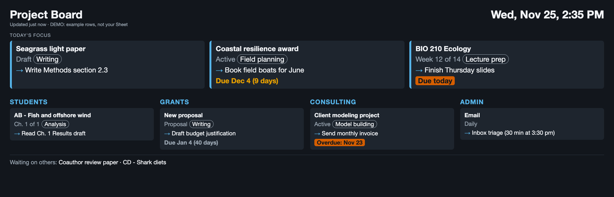

# Project Board

**A wall board for an academic's office TV or second monitor.** It shows every project at a
glance: one card per paper, student, grant, class and admin task, each with where it stands and
the one next task you could finish in an hour or two.

Made by Kris Lewis, PhD, as part of **Research, Reclaimed**. Free under the MIT license.

> **Status: early version (Phase 1).** The board works and reads from a Google Sheet. Calendar
> features (below) are planned, not built. Expect changes.

---

## Who it's for

Faculty, postdocs and graduate students juggling many projects at once, especially if you:
- lose the thread when switching between a manuscript, three students, two grants and a class;
- spend the first 20 minutes of a free hour deciding what to work on;
- want the things you are waiting on (co-author comments, a student's draft) out of your way but not forgotten.

## When you'd use it

**Monday morning:** you open the Sheet, mark three rows `focus_today = yes` and update a few
"next task" cells. The TV shows those three at the top for the rest of the day.

**Between meetings:** you glance up and see the next task on each card, sized for a 1-2 hour block.
You pick one instead of rebuilding your to-do list in your head.

**When a student or visitor is in your office:** add `?visitor=1` to the web address. Student names
become "Student project" and next tasks are hidden.

## What it does

- Reads your rows from a Google Sheet every 5 minutes. **You edit the Sheet, never the board.**
- Shows a **Today's focus** strip (up to three rows you marked), then one block per group
  (Manuscripts, Students, Grants, Consulting, Teaching, Admin, Service).
- Moves anything waiting on someone else into a single **Waiting on others** line at the bottom,
  so the main board shows only work you can act on.
- Colors deadlines: orange within 14 days, red when due or overdue, always with the words too, so
  the colors aren't the only signal. Colors are chosen to be colorblind-safe.
- Never sends your private `notes` column to the page.

## What you still do

Keep the Sheet current. The board is a mirror, not a planner: it doesn't decide priorities for you.

---

## Try it in 30 seconds (no setup)

Download this repository, then double-click `app/Board.html`. It opens in your browser in **demo
mode**, with example rows, so you can see what the board looks like.

## Set it up (about 15 minutes, no coding)

You need a Google account (personal or university Google Workspace).

1. **Make the Sheet.** In Google Sheets, create a new spreadsheet called `Project Board`.
   Choose **File > Import > Upload**, pick `data/rows-example.csv` from this repository, and choose
   **Replace current sheet**. You now have the right column headings and some example rows.
2. **Add the code.** In the Sheet, choose **Extensions > Apps Script**. A code editor opens.
   - Delete what's in `Code.gs` and paste in the contents of `app/Code.gs` from this repository.
   - Click **+** next to *Files*, choose **HTML**, name it `Board` (exactly), and paste in the
     contents of `app/Board.html`.
   - Click the save icon.
3. **Publish it as a private web page.** Click **Deploy > New deployment**. Click the gear icon and
   choose **Web app**. Set *Execute as* **Me** and *Who has access* **Only myself**, then click **Deploy**.
   Google asks you to authorize the script to read your Sheet; allow it. Copy the **Web app URL**.
4. **Open that URL** on the computer connected to your TV (or a second monitor) and make the
   browser full screen. It refreshes itself every 5 minutes.
5. **Replace the example rows with your own.** See [docs/row-design.md](docs/row-design.md) for
   what goes in each column and stage lists that work for papers, students, grants and classes.

After changing the code later: **Deploy > Manage deployments**, click the pencil, set *Version* to
**New version**, then **Deploy**. Changes to the Sheet itself show up on their own.

### Changing it

- **Different groups** (for example, "Lab" or "Outreach"): edit `GROUP_ORDER` and `GROUP_LABEL` near
  the top of the script section of `Board.html`, and use the same names in the Sheet's `group` column.
- **Columns that must stay private**: add their names to `PRIVATE_COLUMNS` in `Code.gs`.
- Or describe the change to Claude, ChatGPT or another assistant, paste in the file, and ask it to
  show you the edit first.

---

## Extras: two Gmail clean-up scripts

In `extras/gmail/`. Both run in Google Apps Script on your own account (script.google.com > New
project, paste, Run). They handle large inboxes by working 5 minutes at a time and restarting
themselves until finished.

| Script | What it does | Changes your mail? |
|---|---|---|
| `inbox-sender-count.gs` | Makes a Google Sheet listing who sends you the most email, how much is unread, and which senders are mailing lists. Useful before deciding what to filter or unsubscribe from. | **No.** Read-only. |
| `archive-by-year.gs` | Labels old inbox conversations by year (for example "2024") and archives them. Conversations with any recent message stay in the inbox. Set the years at the top first. | Archives only. **Nothing is deleted**; archived mail stays searchable under its year label. |

---

## Planned (not built yet)

1. **Calendar:** read your Google Calendar, find open blocks, and propose which next task fits
   each one. You approve before anything is written to the calendar.
2. **Nudges:** a "wrap up, meeting at 2:00" banner on the TV, plus phone or desktop reminders.
3. **Weekly planning helper:** an AI assistant that drafts next week's focus rows from the Sheet,
   for you to accept or change.
4. **A by-topic view:** group similar tasks across projects (for example, all permit paperwork)
   to cut down on switching.

## Privacy

- Your rows stay in your own Google Sheet. The board is served by Google from your account; nothing
  goes to the author or any other service.
- Deploy with *Who has access: Only myself*. Anyone who signs in as you can see it; nobody else can.
- Keep sensitive details (grades, health, personnel matters) out of the Sheet altogether.

## License

MIT. See [LICENSE](LICENSE).
